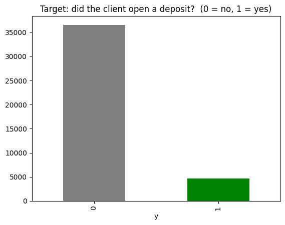
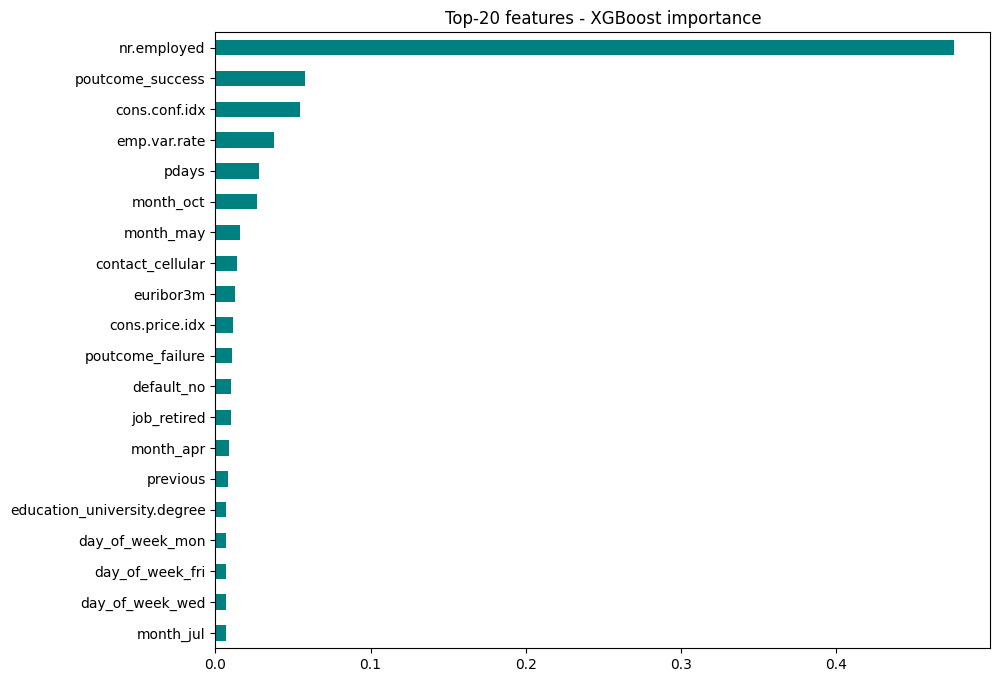
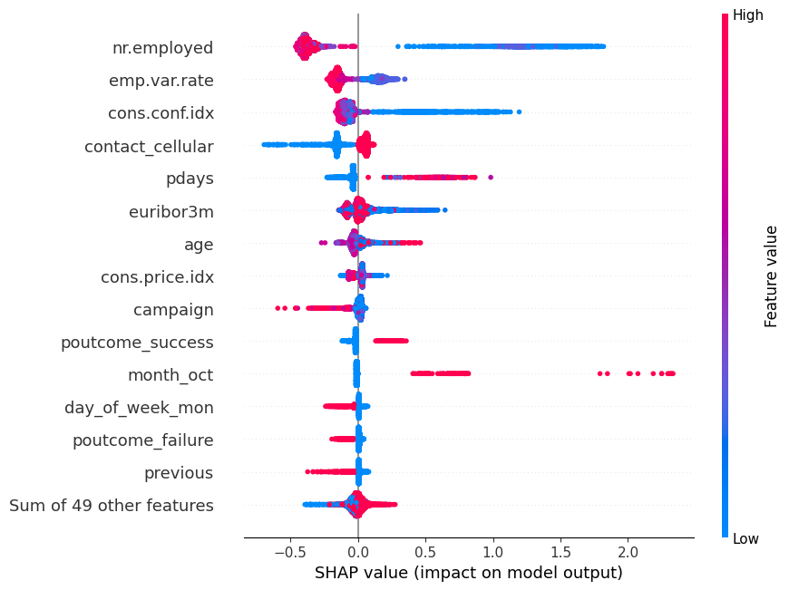
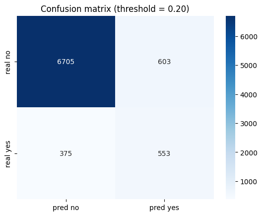

# Bank Marketing: Will the Client Open a Term Deposit?

Mid-term project of the course "Machine Learning для людей".

## Task
A Portuguese bank calls clients and offers them a term deposit. The goal is to build a model that predicts **if a client will say "yes"** (target `y`), and to explain how the model makes its decisions.

Dataset: [bank-additional-full.csv](https://www.kaggle.com/datasets/sahistapatel96/bankadditionalfullcsv) (originally from the [UCI Machine Learning Repository](https://archive.ics.uci.edu/dataset/222/bank+marketing)) — 41,188 clients, 20 features:
- **client data:** age, job, marital status, education, credit default, housing loan, personal loan;
- **last contact:** contact type, month, day of week, call duration;
- **campaign:** number of calls, days since last contact, previous contacts, previous outcome;
- **economy:** employment variation rate, consumer price index, consumer confidence index, Euribor 3m, number of employees.

Only **11.3%** of clients said "yes" — the classes are imbalanced.



## Project structure
```
├── Mid_term_Project.ipynb   # main notebook: EDA, preprocessing, models, tuning, SHAP, error analysis
├── data/
│   └── bank-additional-full.csv
├── src/                     # helper functions used by the notebook
│   ├── preprocessing.py     # load + clean data, new features, outliers, encoder/scaler
│   ├── modeling.py          # pipelines, training + ROC AUC, hyperparameter helpers
│   └── evaluation.py        # best threshold, TP / FP / FN / TN labels for error analysis
├── images/                  # plots used in this README
├── requirements.txt
├── .gitignore
└── README.md
```

The notebook shows every step with explanations; the repeated code lives in `src/`, so the same preprocessing can be reused for new clients.

## What was done
1. **EDA** — distributions, subscription rate per category, correlations, 7 hypotheses.
2. **Metric** — ROC AUC, because the classes are imbalanced (only 11.3% "yes") and the bank needs to *rank* clients.
3. **Preprocessing**
   - removed 12 duplicates;
   - removed `duration` (data leakage: it is known only after the call);
   - kept `unknown` as a separate category;
   - grouped rare categories (`education`: basic.* + illiterate → basic; `default`: yes → unknown);
   - new features: `contacted_before`, `season`; `pdays = 999` → -1;
   - outliers in `campaign` clipped at the 99th percentile;
   - one-hot encoding + StandardScaler in a sklearn Pipeline.
4. **Models**: Logistic Regression, kNN, Decision Tree, XGBoost.
5. **Tuning XGBoost**: `RandomizedSearchCV` and Hyperopt (Bayesian optimization), 5-fold CV.
6. **Interpretation**: XGBoost feature importance and SHAP.
7. **Error analysis**: threshold choice, confusion matrix, comparison of FN / FP groups.

## Results

| Model | Hyperparameters | Train ROC AUC | Val ROC AUC | Comment |
|---|---|---|---|---|
| Logistic Regression | C=1.0, class_weight=balanced | 0.7948 | 0.8005 | Good simple baseline, no overfitting |
| kNN | n_neighbors=100 | 0.8140 | 0.7966 | OK, but slow and hard to explain |
| Decision Tree | max_depth=5, min_samples_leaf=50 | 0.7825 | 0.7916 | Weakest, but easy to read rules |
| XGBoost (default) | n_estimators=100, max_depth=6, lr=0.3 | 0.9030 | 0.7923 | Strong overfitting |
| **XGBoost (Randomized Search)** | n_estimators=200, max_depth=6, lr=0.01, subsample=0.6, gamma=0.5 | 0.8249 | **0.8143** | **Best model** |
| XGBoost (Hyperopt) | n_estimators=500, max_depth=6, lr=0.033, subsample=0.68, gamma=2.6 | 0.8430 | 0.8140 | Almost the same as the best |

Extra experiment: XGBoost **with** `duration` gets val ROC AUC 0.947. This shows the leakage — such a model can not be used before the call.

With threshold 0.20 the best model finds **60% of "yes" clients** with **precision 0.48** (random calling gives only 11%).

## Model interpretation

**XGBoost feature importance**



**SHAP** (red = high feature value, blue = low; right = pushes to "yes")



**Confusion matrix** of the best model on validation (threshold 0.20)



## Main findings
- The most important factors are the **economic situation** (`nr.employed`, `emp.var.rate`, `cons.conf.idx`, `euribor3m`): people open deposits more in periods of low rates and low employment.
- **Previous success** (`poutcome = success`) and being contacted before strongly increase the chance of "yes".
- **Mobile phone** contact works better; **many calls** in one campaign decrease the chance.
- Personal features (job, education) are less important than *when* and *how* the bank calls.

## What can be improved
- More client data: income, balance, other products, the offered deposit rate.
- Try LightGBM / CatBoost and ensembles.
- Choose the decision threshold using real business costs (cost of a call vs. profit from a deposit).
- Retrain the model regularly, because it depends a lot on the economy.

## How to run
```bash
pip install -r requirements.txt
jupyter notebook Mid_term_Project.ipynb
```
The dataset is already in the `data/` folder.
